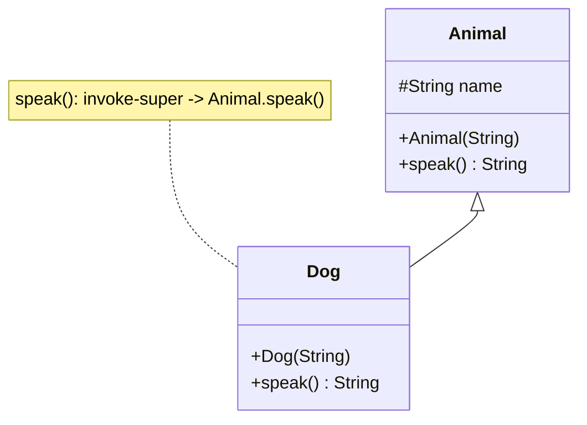

# Example: Inheritance-And-Super-Calls

> [!info] Level 2 — intermediate
> Combines `.super`, a chained constructor, an overriding method, `invoke-super`, and an inherited field read through the subclass.

## Goal

Show what `extends`, `super(...)`, `@Override`, and `super.method()` each turn into in smali, and how to tell an overriding method from a new one when the source is gone. Belongs to [[Classes]].

## Java source

```java
public class Animal {
    protected String name;
    public Animal(String name) { this.name = name; }
    public String speak() { return "..."; }
}

public class Dog extends Animal {
    public Dog(String name) { super(name); }

    @Override
    public String speak() {
        return name + " says woof (" + super.speak() + ")";
    }
}
```

## Generated smali (`Dog` only)

```smali
.class public LDog;
.super LAnimal;
.source "Dog.java"

# direct methods
.method public constructor <init>(Ljava/lang/String;)V
    .locals 0
    invoke-direct {p0, p1}, LAnimal;-><init>(Ljava/lang/String;)V
    return-void
.end method

# virtual methods
.method public speak()Ljava/lang/String;
    .locals 2
    new-instance v0, Ljava/lang/StringBuilder;
    invoke-direct {v0}, Ljava/lang/StringBuilder;-><init>()V
    iget-object v1, p0, LDog;->name:Ljava/lang/String;
    invoke-virtual {v0, v1}, Ljava/lang/StringBuilder;->append(Ljava/lang/String;)Ljava/lang/StringBuilder;
    const-string v1, " says woof ("
    invoke-virtual {v0, v1}, Ljava/lang/StringBuilder;->append(Ljava/lang/String;)Ljava/lang/StringBuilder;
    invoke-super {p0}, LAnimal;->speak()Ljava/lang/String;
    move-result-object v1
    invoke-virtual {v0, v1}, Ljava/lang/StringBuilder;->append(Ljava/lang/String;)Ljava/lang/StringBuilder;
    const-string v1, ")"
    invoke-virtual {v0, v1}, Ljava/lang/StringBuilder;->append(Ljava/lang/String;)Ljava/lang/StringBuilder;
    invoke-virtual {v0}, Ljava/lang/StringBuilder;->toString()Ljava/lang/String;
    move-result-object v0
    return-object v0
.end method
```

## Step by step

1. `extends Animal` is nothing more than `.super LAnimal;`. The class has **no** `.field name` of its own — the field lives in `Animal` and is inherited.
2. `super(name)` is an `invoke-direct` to the parent's `<init>` on the same `p0`. Every constructor must reach exactly one parent (or sibling `this(...)`) constructor before returning; when you see `invoke-direct {p0, ...}, L<Parent>;-><init>`, the `.super` line tells you which class `<Parent>` is.
3. The inherited field is read as `iget-object v1, p0, LDog;->name` — qualified by the class of the reference (`Dog`), not the class that declares it. The runtime resolves `Dog.name` up the hierarchy to `Animal.name`. Don't conclude from the qualifier that `Dog` declares the field; check its `.field` list.
4. `super.speak()` becomes `invoke-super`, which skips virtual dispatch on the receiver's real class and calls the parent's implementation. Plain `this.speak()` would be `invoke-virtual` and recurse forever.
5. `@Override` leaves no trace (it's a source-retention annotation). A method overrides when a supertype has a method with the **same name and descriptor** — here `speak()Ljava/lang/String;` in both. Comparing descriptors against the `.super` class and every `.implements` interface is how you recover overrides from smali.
6. String `+` becomes a `StringBuilder` chain. This listing is typical release output; a debug build usually adds a `move-result-object v0` after each `append`, because the bytecode doesn't know `append` returns its own receiver.

## Diagram



## Compared with real code

- [[Inner-Class-This-Reference-In-PressReader]] — the other kind of "parent": an enclosing class, reached through a synthetic `this$0` field rather than `.super`.
- [[Final-Instance-Methods-Still-Dispatch-Virtually]] — why the real app's calls to its own `final` methods still say `invoke-virtual`.

## See also

- [[Classes]]
- [[Invoke-Direct-Static-Virtual-Interface]] — `invoke-direct`, `invoke-super`, `invoke-virtual`
- [[Interface-Implementation]] — the `.implements` counterpart
- [[Dynamic-Dispatch-Through-Overriding]] in [[Java-Fundamentals]] — the semantics behind virtual dispatch

## References

- [[Dalvik-Bytecode-Bibliography|Bibliography]]
