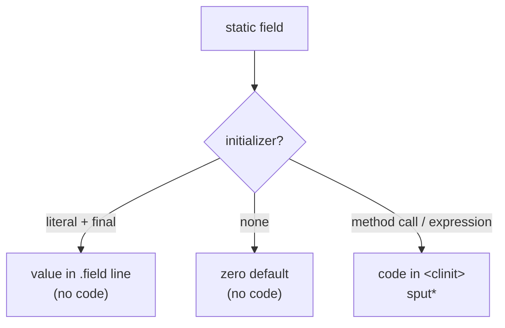

# Example: Static-Fields-And-Class-Initializer

> [!info] Level 1 — basics
> One idea: which static fields need code in `<clinit>` and which are baked straight into the `.field` line.

## Goal

Show the three ways a `static` field can get its value — a compile-time constant, the zero default, and a value computed at runtime — and how only the last one produces code inside the class initializer `static constructor <clinit>()V`. Belongs to [[Classes]].

## Java source

```java
public class Counter {
    public static final String TAG = "Counter";                    // compile-time constant
    private static int created;                                    // zero default
    private static final long START = System.currentTimeMillis();  // computed at runtime

    public Counter() {
        created++;
    }
}
```

## Generated smali

```smali
.class public LCounter;
.super Ljava/lang/Object;
.source "Counter.java"

# static fields
.field public static final TAG:Ljava/lang/String; = "Counter"
.field private static final START:J
.field private static created:I

# direct methods
.method static constructor <clinit>()V
    .locals 2
    invoke-static {}, Ljava/lang/System;->currentTimeMillis()J
    move-result-wide v0
    sput-wide v0, LCounter;->START:J
    return-void
.end method

.method public constructor <init>()V
    .locals 1
    invoke-direct {p0}, Ljava/lang/Object;-><init>()V
    sget v0, LCounter;->created:I
    add-int/lit8 v0, v0, 0x1
    sput v0, LCounter;->created:I
    return-void
.end method
```

## Step by step

1. `TAG` is a `static final` field initialized with a literal, so the compiler stores the value in the DEX file's static-values table: baksmali prints it as `= "Counter"` on the `.field` line, and **no instruction** ever writes it. Callers in other classes usually don't even read the field — `javac` inlines the constant at each use site as a `const-string`.
2. `created` has no initializer, so it starts at the type's zero value (`0`, `false`, `null`) and needs no code either.
3. `START` needs to call a method, which can only happen at runtime, so the compiler emits a `<clinit>`: `invoke-static` → `move-result-wide` (a `long` occupies the pair `v0`/`v1`, see [[Registers]]) → `sput-wide`.
4. `<clinit>` is marked `static constructor` and runs exactly once, the first time the class is actively used (first `new`, first static method call, first non-constant static field access). If a class has no `<clinit>` at all, every one of its static fields is either a constant or a zero default.
5. `created++` in the constructor is a read-modify-write on a static field: `sget` → `add-int/lit8` → `sput`. The `/lit8` form carries the `1` inside the instruction itself (see [[Arithmetic-And-Conversion-Opcodes]]).

## Diagram



## Compared with real code

- [[Kotlin-Enum-Entries-In-PressReader]] — a real `<clinit>` that builds every enum constant with `new-instance` + `sput-object`, then fills the synthetic `$VALUES` and `$ENTRIES` fields.
- [[Reading-A-Native-Facade-Class-Cold]] — a real `<clinit>` whose only job is `System.loadLibrary("encrypt")`.

## See also

- [[Classes]]
- [[Sget-And-Sput]] — `sget`/`sput` opcode reference
- [[Basic-Class-HelloWorld]]
- [[Static-Fields-And-Class-Initialization]] in [[Java-Fundamentals]] — the same idea expressed in the memory model

## References

- [[Dalvik-Bytecode-Bibliography|Bibliography]]
