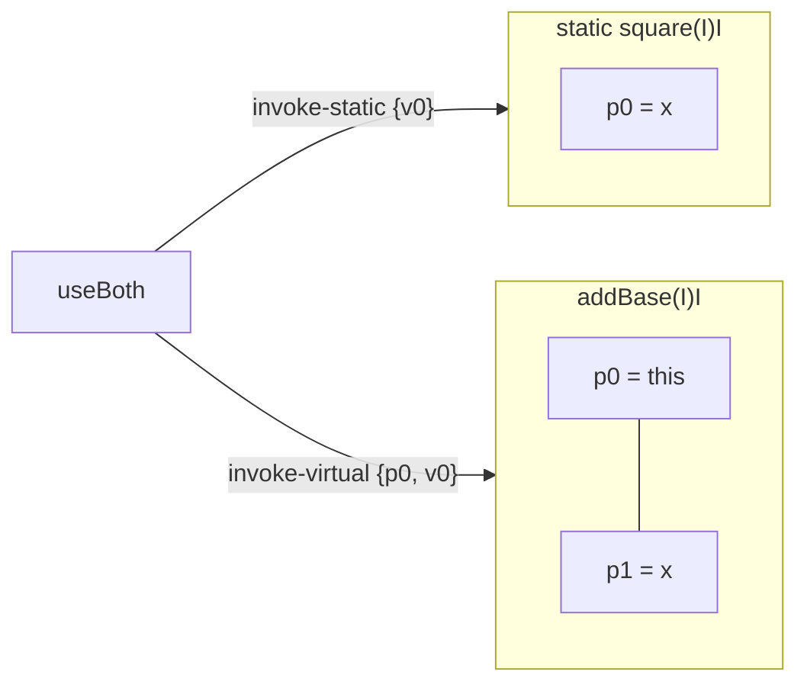

# Example: Static-Vs-Instance-Methods

> [!info] Level 1 — basics
> One idea: the single word `static` decides what `p0` means, which `invoke-*` calls the method, and which section of the class file it lives in.

## Goal

Put a `static` method and an instance method side by side, including one calling the other, so the difference in parameter registers and call instructions is impossible to miss. Belongs to [[Methods]].

## Java source

```java
public class MathUtil {
    private int base;

    public static int square(int x) {
        return x * x;
    }

    public int addBase(int x) {
        return base + x;
    }

    public static int useBoth(MathUtil m) {
        return m.addBase(square(3));
    }
}
```

## Generated smali

```smali
# direct methods
.method public static square(I)I
    .locals 0
    mul-int/2addr p0, p0
    return p0
.end method

.method public static useBoth(LMathUtil;)I
    .locals 1
    const/4 v0, 0x3
    invoke-static {v0}, LMathUtil;->square(I)I
    move-result v0
    invoke-virtual {p0, v0}, LMathUtil;->addBase(I)I
    move-result p0
    return p0
.end method

# virtual methods
.method public addBase(I)I
    .locals 1
    iget v0, p0, LMathUtil;->base:I
    add-int/2addr v0, p1
    return v0
.end method
```

## Step by step

1. **`p0` changes meaning.** In `square(I)I` (static) `p0` is the first parameter `x`. In `addBase(I)I` (instance) `p0` is `this` and `x` is `p1`. The descriptor `(I)I` is identical in both — only the `static` keyword on the `.method` line tells you which interpretation applies. See [[Registers]].
2. **`.locals 0` is legal.** `square` needs no scratch registers: `mul-int/2addr p0, p0` overwrites the parameter in place and returns it. Compilers reuse parameter registers freely once the original value is no longer needed.
3. **Call instruction.** Static methods are called with `invoke-static {args}` — no receiver. Instance methods are called with `invoke-virtual {receiver, args}` — the receiver is always the first register in the braces and becomes the callee's `p0`.
4. **Section headers.** baksmali groups `static`, `private`, and constructor methods under `# direct methods` (they can't be overridden, so they're called without dispatch), and everything else under `# virtual methods`. A quick look at the section tells you how a method will be invoked before you read a single caller.
5. **`move-result` writes into a parameter register.** `move-result p0` in `useBoth` overwrites the `MathUtil m` reference with the returned `int`; `m` is dead at that point, so the register is free.

## Diagram



## Compared with real code

- [[Exercise-10-Synthetic-Lambda-And-Rx-Single]] — R8 turns an instance method into a static one and passes the old `this` as an explicit first parameter; the `p0`-is-`this` rule then no longer holds.
- [[Final-Instance-Methods-Still-Dispatch-Virtually]] — a real app where instance methods stay `invoke-virtual` even when they're `final`.

## See also

- [[Methods]]
- [[Method-with-Parameters]]
- [[Invoke-Direct-Static-Virtual-Interface]]
- [[Move-Result]]
- [[A-Method-Call-Frame]] in [[Java-Fundamentals]] — `this` as an implicit parameter in the semantics

## References

- [[Dalvik-Bytecode-Bibliography|Bibliography]]
