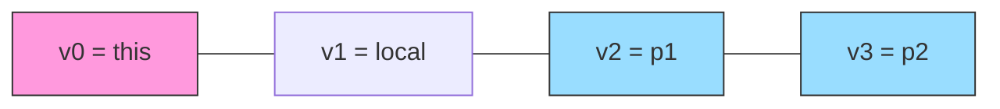
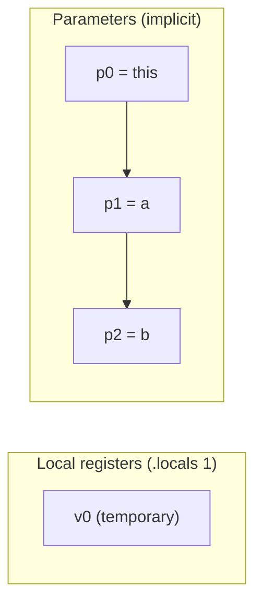

# Registers

Dalvik is a **register-based** virtual machine (unlike the stack-based classic JVM). Every method operates on its own set of numbered registers `v0, v1, v2, ...`, of which the last N are also addressable as `p0, p1, ...` — the method's parameters.

## Storage size and wide values

Each register holds up to 32 bits of data. Whenever a value needs 64 bits (`long`, `double` — see [[Types]]), it is split across **two consecutive registers**: the low-order half in the lower-numbered register, the high-order half in the next one. Such a register pair is usually referred to by its first register only (e.g. "the `long` in `v2`" really means `v2`-`v3`).

```smali
# c = a + b, where a, b, c are all `long` (each spanning 2 registers)
add-long v0, v2, v4     # v0-v1 = (v2-v3) + (v4-v5)
```

Because of this pairing, once a wide value occupies `v2`-`v3`, the next _free_ register is `v4`, not `v3` — a common source of off-by-one confusion when hand-editing smali.

## `.registers` — total register count

```smali
.registers <NUM_REGISTERS>
```

Declares the **total** number of registers used by the method, parameters included. When a method has parameters, they occupy the _last_ N registers of this total.

## `.locals` — local-only count (the common case)

```smali
.locals <NUM_REGISTERS>
```

Declares only the number of **local** registers — the ones that do _not_ hold parameters. Parameters are still available, addressed separately as `p0, p1, ...`, and are not counted here. This is by far the more common directive, since it doesn't require recomputing indices when the parameter list changes.

```
v0, v1, v2, v3, v<N>...
p0, p1, p2, p3, p<N>...
```

`v` registers are used for local variables and temporaries; `p` registers are used for parameters. `p0` is equivalent to Java's `this` keyword — unless the method is `static`, in which case there is no implicit receiver and `p0` is already the first real parameter.

## How `.registers` maps parameters onto `v` registers

When `.registers` is used instead of `.locals`, parameters are stored in the **last** N `v` registers. For example, a method with one local variable and two parameters, declared with `.registers 4`, occupies `v0`-`v3` as follows:

| Register | Role | Notes |
| --- | --- | --- |
| `v0` | `this` | object reference (absent for `static` methods) |
| `v1` | local variable | free for the method's own use |
| `v2` | first parameter (`p1`) | mapped automatically by `.registers` |
| `v3` | second parameter (`p2`) | last register → last parameter |



> [!warning] Changing `.registers` shifts every index
>
> If you go from `.registers 4` to `.registers 5` to make room for one more local variable, **the parameters' indices shift** — because they always sit in the last N registers. Every reference to a parameter or pre-existing local must be updated consistently; forgetting this is one of the most common bugs when hand-patching smali.

### `.locals` — the same example, the common way

```smali
.method public example(II)V
    .locals 1
    # v0 = local variable; p0 = this, p1, p2 = parameters, addressed separately
    ...
.end method
```

Here `.locals 1` declares a **single local register** (`v0`); the parameters (`p0` = `this`, `p1`, `p2`) are automatically available on the side and are not counted in `.locals`.



## Static methods: no `this`

```smali
.method public static sum(II)I
    .locals 1
    add-int v0, p0, p1
    return v0
.end method
```

Being `static`, there is no `this`: `p0` is already the first real parameter (not `v0`/`this` as in the instance-method examples above).

## The `move-*` family and register-to-register copies

Values don't automatically flow between registers — an explicit `move` is required whenever a value needs to be relocated, e.g. after a method call whose result must be read out of the "result register":

| Instruction | Moves |
| --- | --- |
| `move` | a 32-bit value between two registers |
| `move-wide` | a 64-bit value between two register pairs |
| `move-object` | an object reference between two registers |
| `move-result` | the 32-bit return value of the last `invoke-*` into a register |
| `move-result-wide` | the 64-bit return value of the last `invoke-*` |
| `move-result-object` | the object reference returned by the last `invoke-*` |
| `move-exception` | the currently-handled exception into a register, at the start of a catch block (see [[Methods]]) |

## Tracing where a value came from: search by field, not by eye

A register (`v3`, `p1`, ...) never carries a source-level variable name — `baksmali` only ever prints the numbered register itself, never "this is the `serviceUrl` variable". So when a method is long and the question is "where does `this.someField`'s value end up, and what happens to it downstream?", the answer is never "read the whole method top to bottom" — it's a two-step search:

1. **Search for the field, not the register.** [[Iget-And-Iput]]/[[Sget-And-Sput]] always spell out the exact declaring class and field name (`Lclass;->field:T`) in full — that string is the one thing about a field that's guaranteed to appear literally, verbatim, everywhere the field is read or written. Grepping for it (or `Ctrl+F`-ing it in an editor) finds every entry point in one pass, instead of scanning instruction-by-instruction hoping to spot the right `iget`/`sget`.
2. **Follow the destination register forward from that exact line.** Once you've found `iget-object vN, ..., Lclass;->field:T`, `vN` now holds the field's value, from that instruction onward — the rest is ordinary register tracing (see [[Reading-Raw-Dalvik]]'s checklist items 5 and 6 for the register-aliasing/swap hazards that can complicate this step specifically).

```smali
.method public final m(Lcom/newspaperdirect/pressreader/android/core/Service;Ljava/lang/String;II)V
    .registers 26
    move-object/from16 v1, p0                       # v1 = this
    move-object/from16 v2, p1
    const-string v3, "wc"
    const-string v4, " (wc:"
    const-string v5, "@"
    const-string v6, "HttpRequestHelper"
    iget-object v7, v1, Lbp/m1;->a:Ljava/lang/String;   # v7 = this.a, from here on
    const/4 v8, 0x1
    invoke-static {v8}, Landroid/net/TrafficStats;->setThreadStatsTag(I)V
```

(the opening lines of `bp.m1`'s own `m()` method — see [[Reading-A-Field-By-Searching-Its-Descriptor]] for the full snippet note)

> [!warning] A decompiler's field name may not be the raw smali's field name
>
> JADX renders this same field as `f8639a` in its Java reconstruction of `bp.m1` (see [[m1.java]]), not `a` — its own `/* JADX INFO: renamed from: a, reason: collision with root package name */` comment says why: JADX renames a field when its real short name would collide with something else in the Java it's generating (here, the field named `a` collides with the single-letter subpackage segment convention JADX uses internally). Searching raw `.smali` for `f8639a` finds **nothing** — the bytecode itself only ever knew the field as `a`. When starting from a decompiler's output, always check for a "renamed from" comment before grepping the real smali by name; otherwise the search silently finds zero matches and looks like the field is never read at all, which is the opposite of what's actually true.

## More examples

Ordered from simplest to most complex, two per level: **Level 1** isolates one idea on minimal hand-written code, **Level 2** combines ideas or shows a compiler idiom, **Level 3** is real code from an analysed app, compared against its source or reconstruction.

### Level 1 — basics

- [[Constructor-and-Fields]] — an explicit `.registers` layout in practice
- [[Counting-Locals-And-Parameters]] — deriving the full `v`↔`p` map from the descriptor and `.locals`, wide parameters included

### Level 2 — intermediate

- [[Wide-Registers-For-Long-And-Double]] — the `-wide` opcode family, `cmp-long`, and dead pairs being recycled
- [[Invoke-Range-For-Many-Arguments]] — `/range` calls and the register shuffle in front of them

### Level 3 — real code

- [[Device-Id-Wide-Register-Uuid]] — a real app packing two 32-bit hash codes into one 64-bit `UUID` constructor call via `shl-long/2addr`
- [[Reading-A-Field-By-Searching-Its-Descriptor]] — the field-search technique above, in full, on a real app

### Further practice

- [[Exercise-01-Outlined-StringBuilder-Helpers]] — `p` registers in `static` methods (`p0` as the first parameter, no `this`) and in-place `/2addr` arithmetic
- [[Exercise-02-HttpURLConnection-Factory]] — aggressive reuse of both local (`v0`) and parameter (`p0`) registers across different types within a single method
- [[Exercise-07-Wait-Loop-Under-A-Monitor]] — wide register pairs (`const-wide/32 v1, 0xea60` occupying `v1`-`v2` for `Object.wait(long)`) and parameter register recycling
- [[Exercise-08-Server-Mode-Map-Constructor]] — tracking five URL parameter registers as each is overwritten with a `kotlin.Pair` object in turn before `filled-new-array`

## See also

- [[Classes]] — direct vs virtual methods
- [[Methods]] — method declaration and `.locals`/`.line`
- [[Types]] — size of 64-bit types and register pairs
- [[Dalvik-Instructions|Instructions]] — full instruction catalogue, including the `move-*`/arithmetic families
- [[Move-Result]], [[Iget-And-Iput]], [[Sget-And-Sput]], [[Arithmetic-And-Conversion-Opcodes]] — opcode reference entries
- [[Smali-Exercises]] — graded exercises practicing register tracking across short and 300-instruction methods

## References

- [[Dalvik-Bytecode-Bibliography|Bibliography]]

## Flashcards
#flashcards

Why do `long` and `double` values occupy two registers instead of one?::Because Dalvik registers are 32 bits wide, and both types are 64-bit; the value is split across two consecutive registers.
What is the key difference between `.locals` and `.registers`?::`.locals` counts only local (non-parameter) registers, with parameters addressed separately as `p0..pN`; `.registers` counts the total (locals + parameters), with parameters occupying the last N registers of that total.
What happens to `p0` in a static method compared to an instance method?::In an instance method `p0` holds `this`; in a static method there is no `this`, so `p0` is already the first real parameter.
You want to know where a class field's value ends up in a long, unfamiliar method. Why is searching for the field's name in general the wrong first move?::Registers carry no source-level name, and a plain field name is often too short/common to search for reliably. The one thing guaranteed to appear literally is the field's full descriptor (`Lclass;->field:T`) inside an `iget*`/`iput*`/`sget*`/`sput*` instruction — search for that exact string, then follow the register it loads into forward from that line.
Why might grepping raw smali for a field name taken from a JADX-decompiled `.java` file come back with zero matches, even though the field really is used?::JADX sometimes renames a field in its Java reconstruction to avoid a Java-identifier collision that doesn't exist in the bytecode itself (flagged by its own "renamed from" comment) — the raw smali only ever used the original, usually shorter, name, so searching for the decompiler's renamed version finds nothing.
