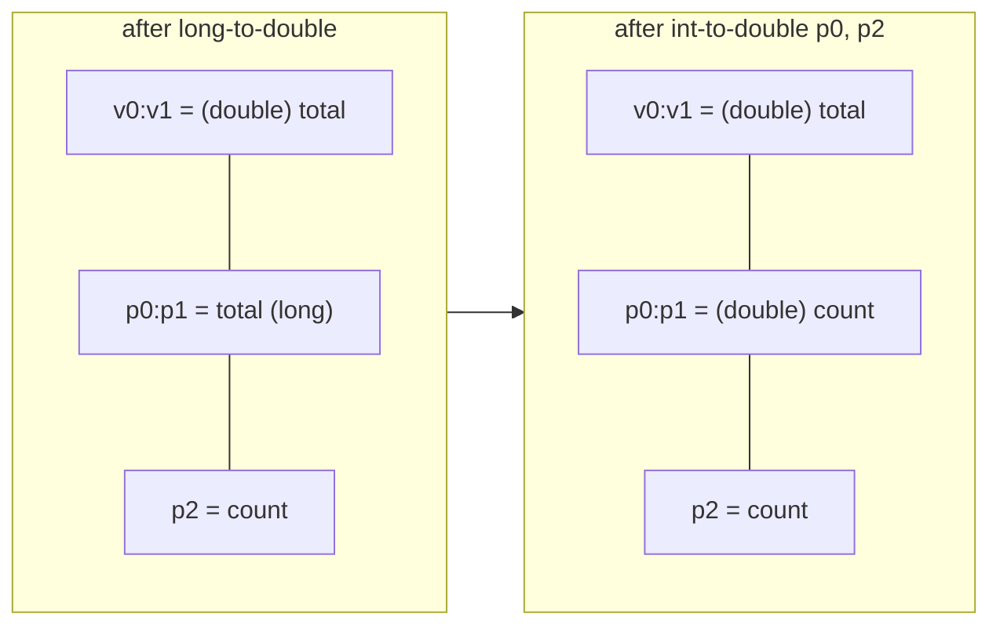

# Example: Wide-Registers-For-Long-And-Double

> [!info] Level 2 — intermediate
> `long`/`double` values in register pairs: the `-wide` opcode family, `cmp-long` before a branch, and a pair being overwritten by a narrower value once it's dead.

## Goal

Show the instructions that only exist because 64-bit values need two registers, and the overlap rules a reader has to respect when tracking them. Belongs to [[Registers]].

## Java source

```java
public class Timing {
    static double average(long total, int count) {
        if (count == 0) return 0.0;
        return (double) total / count;
    }

    static long clampMillis(long t) {
        return t > 60000L ? 60000L : t;
    }
}
```

## Generated smali

```smali
.method static average(JI)D
    .locals 2
    # p0/p1 = total (wide), p2 = count
    if-nez p2, :cond_0
    const-wide/16 v0, 0x0
    return-wide v0
    :cond_0
    long-to-double v0, p0
    int-to-double p0, p2
    div-double/2addr v0, p0
    return-wide v0
.end method

.method static clampMillis(J)J
    .locals 3
    const-wide/32 v0, 0xea60
    cmp-long v2, p0, v0
    if-lez v2, :cond_0
    return-wide v0
    :cond_0
    return-wide p0
.end method
```

## Step by step

1. **Everything 64-bit has a `-wide` opcode**: `const-wide/16`, `const-wide/32`, `move-wide`, `move-result-wide`, `return-wide`, `sget-wide`/`iget-wide`/`aget-wide`. If you see `return-wide`, the method returns `long` or `double` — the descriptor's last letter (`J`/`D`) tells you which.
2. **The constant `0.0`** is `const-wide/16 v0, 0x0`. The instruction doesn't say "double": a zero bit pattern is `0L` and `0.0` alike. The type comes from how the pair is used next (`return-wide` in a `D` method).
3. **Conversions name both types**: `long-to-double v0, p0` reads the pair `p0`/`p1` and writes the pair `v0`/`v1`.
4. **A dead pair gets recycled.** `int-to-double p0, p2` writes a `double` into `p0`/`p1`, destroying `total`. It's safe because `total` isn't used again — but a careless reader who keeps thinking "`p0` = total" gets the division wrong. When a parameter register is the *destination* of an instruction, its old meaning ends there.
5. **No direct `if-gt` on longs.** Dalvik's `if-*` only compare 32-bit registers, so 64-bit comparisons go through `cmp-long v2, p0, v0`, which writes `-1`/`0`/`1` into a normal register; then `if-lez v2` branches on that. `cmp-long` + `if-*z` is the long-comparison idiom (floating-point has `cmpl-double`/`cmpg-double`, which differ only in how `NaN` is ordered).
6. **`0xea60` = 60000.** Decoding hex constants into decimal is often what reveals intent — 60000 ms is one minute.

## Diagram



## Compared with real code

- [[Exercise-07-Wait-Loop-Under-A-Monitor]] — the very same `const-wide/32 ..., 0xea60` in a real app, passed to `Object.wait(long)` as a 60-second timeout.
- [[Device-Id-Wide-Register-Uuid]] — two wide values built with `int-to-long` and `shl-long`, then passed as pairs to the `UUID(long, long)` constructor.

## See also

- [[Registers]]
- [[Counting-Locals-And-Parameters]]
- [[Arithmetic-And-Conversion-Opcodes]] — `*-to-*`, `cmp-long`, `div-double`
- [[Conditional-Branches]]

## References

- [[Dalvik-Bytecode-Bibliography|Bibliography]]
