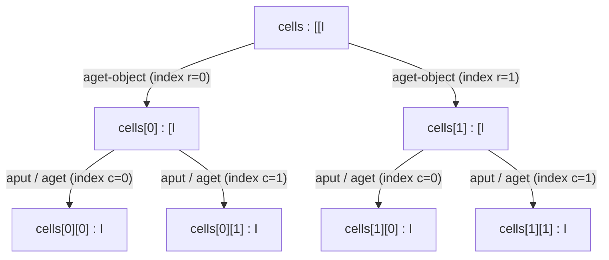

# Example: Multidimensional Arrays

How arrays and multi-dimensional arrays are declared and used in smali, building on the syntax introduced in [[Types]].

## Java source

```java
public class Grid {
    private int[][] cells;

    public Grid(int rows, int columns) {
        cells = new int[rows][columns];
    }

    public void set(int r, int c, int value) {
        cells[r][c] = value;
    }
}
```

## Generated smali

```smali
.class public LGrid;
.super Ljava/lang/Object;

.field private cells:[[I

.method public constructor <init>(II)V
    .locals 2
    invoke-direct {p0}, Ljava/lang/Object;-><init>()V
    sget-object v0, Ljava/lang/Integer;->TYPE:Ljava/lang/Class;
    filled-new-array {p1, p2}, [I
    move-result-object v1
    invoke-static {v0, v1}, Ljava/lang/reflect/Array;->newInstance(Ljava/lang/Class;[I)Ljava/lang/Object;
    move-result-object v0
    check-cast v0, [[I
    iput-object v0, p0, LGrid;->cells:[[I
    return-void
.end method

.method public set(III)V
    .locals 1
    # p0 = this, p1 = r, p2 = c, p3 = value
    iget-object v0, p0, LGrid;->cells:[[I
    aget-object v0, v0, p1
    aput p3, v0, p2
    return-void
.end method
```

## Step by step

1. The `int[][]` field becomes `.field private cells:[[I` — two `[` for two dimensions ([[Types]]).
2. Because `new-array` only allocates a single dimension at a time, `javac`/`d8` compiles `new int[rows][columns]` by packing `{p1, p2}` into a two-element `[I` dimensions array via [[Array-Length-And-New-Array|`filled-new-array`]] + [[Move-Result|`move-result-object`]], passing `Integer.TYPE` (`int.class`) and that `[I` to `Array.newInstance(Class, int[])`, and narrowing the returned `Object` with `check-cast v0, [[I` ([[New-Instance-And-Check-Cast]]).
3. Multi-dimensional arrays in Java/Dalvik are arrays of arrays (each row `cells[r]` is an independent `[I` reference). In `set(III)V`, [[Iget-And-Iput|`iget-object`]] loads the outer `[[I` reference into `v0`, [[Aget-And-Aput|`aget-object v0, v0, p1`]] fetches the row `cells[r]` (still an object reference, of type `[I`), and [[Aget-And-Aput|`aput p3, v0, p2`]] writes the 32-bit `int` `value` (`p3`) into `row[c]`.

> [!note] Jagged vs rectangular allocation
>
> If only the outer dimension is given (`new int[rows][]`), the compiler emits a single `new-array v0, p1, [[I` instead of calling `Array.newInstance`, leaving each `cells[r]` slot `null` until populated individually with `new-array ..., [I` and `aput-object`.

## Diagram



## See also

- [[Types]] — array descriptors
- [[Registers]]
- [[Array-Length-And-New-Array]] — `new-array` and `filled-new-array`
- [[Aget-And-Aput]] — `aget-object` and `aput`
- [[Exercise-08-Server-Mode-Map-Constructor]] — `filled-new-array` in real Kotlin code

## References

- [[Dalvik-Bytecode-Bibliography|Bibliography]]
