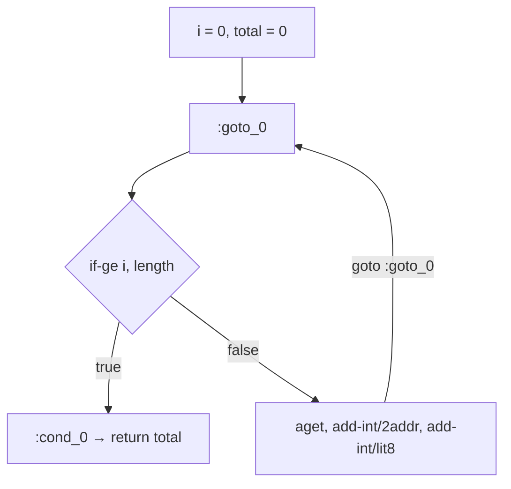

# Example: For-Loop-Over-An-Array

> [!info] Level 1 — basics
> One idea: a loop is a label, a test that jumps *out*, a body, and a `goto` back — and small differences in that shape reveal whether the source used an index or a for-each.

## Goal

Compile the same array sum two ways — indexed `for` and for-each — and learn to read the loop skeleton (`:goto_0` … `if-ge` … `goto :goto_0`) directly. Belongs to [[Dalvik-Instructions]].

## Java source

```java
public class Sums {
    static int sumIndexed(int[] xs) {
        int total = 0;
        for (int i = 0; i < xs.length; i++) total += xs[i];
        return total;
    }

    static int sumForEach(int[] xs) {
        int total = 0;
        for (int x : xs) total += x;
        return total;
    }
}
```

## Generated smali

```smali
.method static sumIndexed([I)I
    .locals 3
    const/4 v0, 0x0          # i = 0
    move v1, v0              # total = 0
    :goto_0
    array-length v2, p0      # xs.length, re-read every iteration
    if-ge v0, v2, :cond_0    # exit when i >= length
    aget v2, p0, v0          # xs[i]
    add-int/2addr v1, v2     # total += xs[i]
    add-int/lit8 v0, v0, 0x1 # i++
    goto :goto_0
    :cond_0
    return v1
.end method

.method static sumForEach([I)I
    .locals 4
    array-length v0, p0      # length read ONCE, before the loop
    const/4 v1, 0x0          # hidden index
    move v2, v1              # total = 0
    :goto_0
    if-ge v1, v0, :cond_0
    aget v3, p0, v1
    add-int/2addr v2, v3
    add-int/lit8 v1, v1, 0x1
    goto :goto_0
    :cond_0
    return v2
.end method
```

## Step by step

1. **The skeleton.** `:goto_0` marks the loop header; `if-ge … :cond_0` is the exit test; `goto :goto_0` is the back edge. A `goto` to a label *above* it is the one signal that means "loop".
2. **The test is inverted.** The source says "continue while `i < length`"; the bytecode says "leave if `i >= length`". Dalvik branches jump when the condition is true, so compilers emit the negation of the source condition to skip over the body. Read `if-ge` as "loop while `<`".
3. **Same register, two initial values.** `const/4 v0, 0x0` then `move v1, v0` — both `i` and `total` start at `0`, and D8 creates the zero once and copies it.
4. **Indexed vs for-each.** In `sumIndexed`, `array-length` is *inside* the loop because the source evaluates `xs.length` on every test. In `sumForEach`, the compiler hoisted it above `:goto_0` and introduced an index variable the source never named. A length read once before the header is the fingerprint of a for-each loop over an array.
5. **`aget` has a type family**: `aget` (int/float), `aget-wide`, `aget-object`, `aget-boolean`, `aget-byte`, `aget-char`, `aget-short`. The suffix tells you the element type even when the array came from somewhere opaque ([[Aget-And-Aput]]).
6. **No bounds check instruction.** `aget` itself throws `ArrayIndexOutOfBoundsException`; the explicit `if-ge` is the program's loop condition, not a safety check.

## Diagram



## Compared with real code

- [[Exercise-06-Static-Monitors-And-Iterators]] — a real loop over a collection, where the skeleton is the same but the test is `Iterator.hasNext()` + `if-eqz`.
- [[String-Equals-Chain-In-PressReader]] — real forward-only control flow (no back edge), for contrast.

## See also

- [[Dalvik-Instructions]]
- [[Conditional-Branches]]
- [[Array-Length-And-New-Array]]
- [[Loop-As-Backward-Branch]] in [[ARM64-Android]] — the same loop shape in native code
- [[For-Loop-As-Desugared-While]] in [[Java-Fundamentals]]

## References

- [[Dalvik-Bytecode-Bibliography|Bibliography]]
