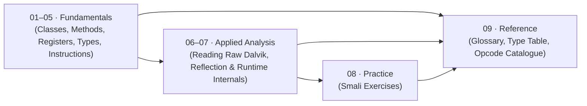
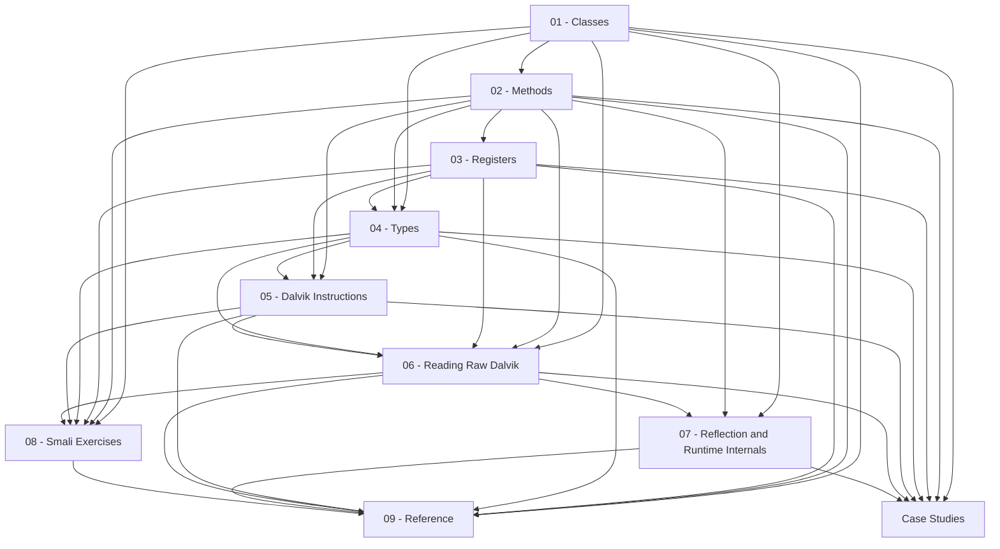

# Dalvik-Bytecode

Studying **Dalvik bytecode**, the assembly language of the Android virtual machine (Dalvik/ART), as seen in the `.smali` files produced by disassembling APKs. This topic started as an expanded, digitized version of a set of handwritten notes taken while first learning to read it — see this topic's own `README.md` for the full background story and the original scanned pages.

> [!warning] Ethical use
>
> This material is for educational and personal-research purposes around reverse engineering. Reversing third-party applications should always respect licenses, terms of service, and applicable local regulations.

## Map of this topic

| Section | Covers |
| --- | --- |
| [[Classes]], [[Methods]], [[Registers]], [[Types]], [[Dalvik-Instructions\|Instructions]] | core Dalvik syntax: class/method directives, the `v`/`p` register frame, type descriptors, and instruction families |
| [[Reading-Raw-Dalvik\|Reading Raw Dalvik]] | reading obfuscated smali with no comments, and hand-patching Dalvik methods |
| [[Reflection-and-Runtime-Internals\|Reflection and Runtime Internals]] | reflection as an anti-analysis technique, JVM/ART runtime architecture, method dispatch, memory management |
| [[Smali-Exercises\|Smali Exercises]] | twelve graded rewrite-the-source exercises on real PressReader smali, with folded solutions |
| [[Dalvik-Bytecode-Reference\|Reference]] | glossary, bibliography, type table, vault-wide opcode/example/snippet listings for this topic |

## Relevant standalone notes

Case studies, cheatsheets, tools, reading notes, and projects aren't scoped to this topic alone — they live once, shared vault-wide. These are the ones that draw on Dalvik-Bytecode so far:

- [[Tua-Case-Study]] in [[Case-Studies]] — anti-tampering/obfuscation patterns in a real app's smali
- [[PressReader]] in [[Case-Studies]] — the XML API classes the [[Smali-Exercises]] are built from
- [[Poste-Italiane]] in [[Case-Studies]] — commercial protector triage combining Java/Dalvik entry points with native loader unpacking

## Chapters

Reading order matters here more than usual — each chapter leans on the ones before it:

1. [[Classes]] (`01-Classes/`) — `.class`, `.super`, `.implements`, `.field`, direct vs virtual methods
2. [[Methods]] (`02-Methods/`) — `.method`, constructors, `<init>`/`<clinit>`, `invoke-*`, exception handling
3. [[Registers]] (`03-Registers/`) — `.registers`, `.locals`, `v`/`p`, `this`, wide register pairs
4. [[Types]] (`04-Types/`) — primitive types, arrays, method descriptors
5. [[Dalvik-Instructions|Instructions]] (`05-Dalvik-Instructions/`) — catalogue of instruction families
6. [[Reading-Raw-Dalvik|Reading Raw Dalvik]] (`06-Reading-Raw-Dalvik/`) — reading obfuscated smali cold, and hand-patching Dalvik methods
7. [[Reflection-and-Runtime-Internals|Reflection and Runtime Internals]] (`07-Reflection-and-Runtime-Internals/`) — reflection as an anti-analysis technique, JVM/ART runtime architecture, method dispatch internals, memory management
8. [[Smali-Exercises|Smali Exercises]] (`08-Smali-Exercises/`) — graded exercises: rewrite real PressReader smali as Java/Kotlin, then check against folded solutions
9. [[Dalvik-Bytecode-Reference|Reference]] (`09-Reference/`) — glossary, bibliography, type table, vault-wide opcode/example/snippet listings

## Where to start

1. Start with [[Classes]] to see how Dalvik represents Java classes.
2. Continue with [[Methods]] and [[Registers]].
3. Round it off with [[Types]] and [[Dalvik-Instructions|Instructions]].
4. Each chapter's own `examples/` subfolder has worked walkthroughs — or browse them all at once via the Dataview table in [[Dalvik-Bytecode-Reference|Reference]].
5. Once the fundamentals feel solid, [[Reading-Raw-Dalvik|Reading Raw Dalvik]] puts them all to work on real, heavily obfuscated smali, and covers how to hand-patch a method once you understand it.
6. [[Reflection-and-Runtime-Internals|Reflection and Runtime Internals]] goes one level deeper, into what the runtime (JVM concepts, and how ART actually implements them) does with a method call — and why that's exactly what reflection-based obfuscation exploits to hide calls from static analysis.
7. To measure how well it all stuck, work through [[Smali-Exercises|Smali Exercises]]: rewrite real methods from source-less smali, then grade yourself against the folded solutions.
8. For a full, real-world investigation of one app at a time (rather than a small chapter-scoped fragment), see [[Case-Studies]].

## See also

- [[Home]]
- [[Java-Fundamentals]] — the operational-semantics model of the *source* language Dalvik encodes: what a class, object, field access, method call, `this`, and the library/stack/heap memory regions actually mean, so a `new-instance`/`iget`/`invoke-*`/`p0` isn't just an opcode but a known construct. Read it alongside [[Reflection-and-Runtime-Internals]] for the runtime-internals half.
- [[ARM64-Android]] — the native/register-machine side of Android reverse engineering: what you're reversing whenever there's no more Dalvik bytecode left to read (a JNI `.so`, or a Flutter app's Dart AOT snapshot)
- [[Frida-Dynamic-Instrumentation]] — the dynamic-instrumentation counterpart to static smali reading and hand-patching: hooking Java/ART methods and native functions at runtime when static decoding or control-flow reconstruction alone isn't cost-effective
