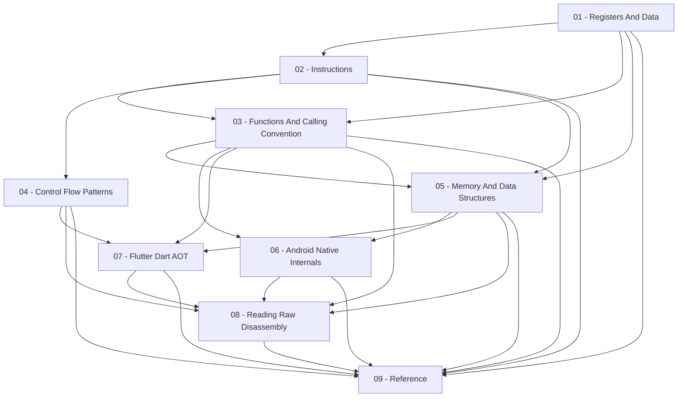

# ARM64-Android

Reading and statically analyzing **ARM64 machine code compiled for Android** — from the instruction set itself, through the AArch64 procedure call standard, up to the two shapes of native code you actually meet when reversing a real app: classic JNI/NDK shared libraries, and the AOT-compiled Dart code inside a Flutter app's `libapp.so`. Where [[Dalvik-Bytecode]] covers the managed, register-based bytecode the ART interpreter/JIT runs, this topic covers the native machine code sitting right next to it — the layer you're forced into whenever a class file just calls into a `.so` and there's no bytecode left to read.

> [!warning] Ethical use
>
> This material is for educational and personal-research purposes around reverse engineering and mobile security. Reversing or analyzing third-party applications and native libraries should always respect their licenses, terms of service, and applicable local regulations.

## Map of this topic

| Section | Covers |
| --- | --- |
| [[ARM64-Android-Reference\|Reference]] | glossary, bibliography, vault-wide reference-entry/example/snippet listings for this topic |

## Relevant standalone notes

Case studies, cheatsheets, tools, reading notes, and projects aren't scoped to this topic alone — they live once, shared vault-wide. These are the ones that draw on ARM64-Android:

- [[ClasseViva-Case-Study]], [[Poste-Italiane]] in [[Case-Studies]]
- [[AAPCS64-Quick-Reference]], [[Dart-AOT-Stub-Cheatsheet]] in [[Cheatsheets]]
- [[Blutter]], [[Frida]], [[Ghidra]], [[Objdump-And-Readelf]] in [[Tools]]
- [[Aapcs64-Specification]] in [[Reading-Notes]]

## Chapters

Reading order matters here — the first five chapters build the general AArch64 and managed-heap foundation, chapters 6 and 7 branch into the two concrete Android native targets (NDK/JNI vs. Flutter/Dart AOT), and chapter 8 synthesizes everything on stripped, unannotated disassembly:

1. [[Registers-And-Data]] (`01-Registers-And-Data/`) — the AArch64 register file, data types/sizes, and the extra reserved-register roles Android runtimes (ART, the Dart VM) layer on top of the standard ABI.
2. [[Instructions]] (`02-Instructions/`) — the instruction classes you actually need: data processing, load/store, branches, comparisons, bitfield extraction.
3. [[Functions-And-Calling-Convention]] (`03-Functions-And-Calling-Convention/`) — AAPCS64 parameter passing and stack frames, and how the Dart VM's own frame convention (`EnterFrame`/`CheckStackOverflow`/`LeaveFrame`) diverges from it.
4. [[Control-Flow-Patterns]] (`04-Control-Flow-Patterns/`) — recognizing `if`/`else`, loops, and `switch`-shaped dispatch once they've been flattened into compares and branches.
5. [[Memory-And-Data-Structures]] (`05-Memory-And-Data-Structures/`) — object layout, field access, tagged integers, arrays, strings, heap allocation — reading raw loads/stores back into "this is a field access", "this is a boxed int".
6. [[Android-Native-Internals]] (`06-Android-Native-Internals/`) — the ELF shape of an Android `.so`, JNI's calling convention, and how Java/Kotlin code on the ART side calls into native code and back.
7. [[Flutter-Dart-AOT]] (`07-Flutter-Dart-AOT/`) — how Dart's AOT compiler targets ARM64: the object pool, the global dispatch table, stubs, closures, `async`/`await`, and why Flutter apps need this chapter instead of chapter 6.
8. [[Reading-Raw-Disassembly]] (`08-Reading-Raw-Disassembly/`) — the capstone: everything from chapters 1–7, applied with none of blutter's synthetic comments to lean on — real excerpts stripped down to bare addresses and mnemonics, read cold.
9. [[ARM64-Android-Reference|Reference]] (`09-Reference/`) — glossary, bibliography, instruction reference entries, and the aggregated examples/snippets/reference-entry listings for this topic.

## Where to start

1. Start with [[Registers-And-Data]] and [[Instructions]] to get the AArch64 register roles (`X0`–`X30`, `SP`, `XZR`, `NZCV`) and the five everyday instruction families under your fingers, using the `#reference-entry` notes in [[ARM64-Android-Reference|Reference]] for deep dives on individual instruction groups.
2. Read [[Functions-And-Calling-Convention]] next — knowing how AAPCS64 and the Dart VM set up frames and pass parameters is what lets you find function boundaries and track local variables on the stack.
3. Continue through [[Control-Flow-Patterns]] and [[Memory-And-Data-Structures]] to recover high-level control flow (`if`/`else`, loops, jump tables, enum switches) and data layouts (C structs vs. Dart tagged pointers, compressed pointers, Smis, and write barriers).
4. Branch depending on your target: read [[Android-Native-Internals]] if you are reversing a C/C++/Rust NDK `.so` called via JNI, or [[Flutter-Dart-AOT]] if you are reversing a Flutter app's `libapp.so` (or read both to see where `MethodChannel` bridges the two).
5. Finish with [[Reading-Raw-Disassembly]] to practice recovering function signatures, control flow, and object layouts cold from unannotated instruction streams, and see [[Case-Studies]] (especially [[ClasseViva-Case-Study]] and [[Poste-Italiane]]) for full real-world investigations.

## See also

- [[Home]]
- [[Dalvik-Bytecode]] — the managed-bytecode half of Android reverse engineering: reading the `.smali` code that either calls into your JNI `.so` (`native` methods and `System.loadLibrary`) or hosts the Flutter engine (`libflutter.so`).
- [[Frida-Dynamic-Instrumentation]] — the dynamic counterpart to this topic: hooking native ARM64 functions at runtime with `Interceptor.attach`, tracing indirect jumps and GDT calls with Stalker, and dumping live registers and heap objects when static disassembly reaches its limits.
- [[Java-Fundamentals]] — the source-language and memory-model foundation for the Java/Kotlin side that crosses the JNI boundary in [[Android-Native-Internals]].
