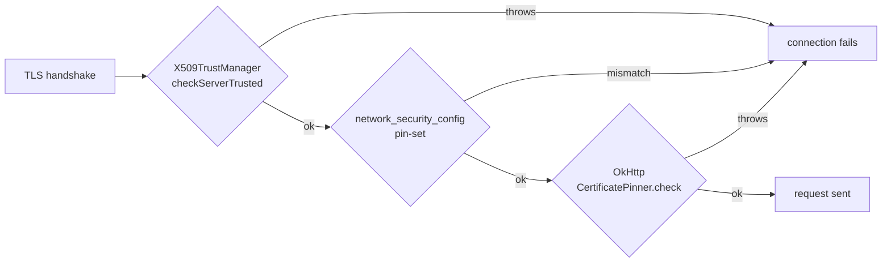

# Example: Bypassing-Pinning-With-A-Custom-TrustManager

> [!info] Level 2 — intermediate
> Combines class creation with a framework hook: build a permissive `X509TrustManager` in JavaScript with `Java.registerClass`, and swap it into every `SSLContext` the app initializes — covering pinning done by custom trust managers, not just OkHttp's pinner.

## Goal

Defeat certificate validation that lives in an app-supplied `TrustManager`, and understand why this layer is different from `CertificatePinner`. Belongs to [[Network-Interception]].

## Script

```javascript
Java.perform(() => {
    const X509TrustManager = Java.use("javax.net.ssl.X509TrustManager");
    const SSLContext = Java.use("javax.net.ssl.SSLContext");

    const TrustAll = Java.registerClass({
        name: "dev.frida.TrustAll",
        implements: [X509TrustManager],
        methods: {
            checkClientTrusted(chain, authType) {},
            checkServerTrusted(chain, authType) {},
            getAcceptedIssuers() { return []; }
        }
    });
    const trustAll = Java.array("javax.net.ssl.TrustManager", [TrustAll.$new()]);

    SSLContext.init.overload(
        "[Ljavax.net.ssl.KeyManager;", "[Ljavax.net.ssl.TrustManager;", "java.security.SecureRandom"
    ).implementation = function (km, tm, rnd) {
        console.log(`[*] SSLContext.init: replacing ${tm ? tm.length : 0} trust manager(s)`);
        this.init(km, trustAll, rnd);
    };
});
```

## Step by step

1. **Where validation happens.** During the handshake, JSSE asks the context's `X509TrustManager.checkServerTrusted(chain, authType)` whether to accept the server chain; throwing rejects it. Apps that pin "by hand" ship their own trust manager that compares the chain against embedded certificates.
2. **`Java.registerClass`** creates a real Java class at runtime: a name, the interfaces it implements, and JS implementations of each method. Empty `checkServerTrusted` = accept everything.
3. **`SSLContext.init(km, tm, random)`** is where every custom trust manager is installed. Replacing its `tm` argument redirects all contexts — the app's, its SDKs', OkHttp's if it was given that context.
4. **Array arguments**: overload strings use JVM array descriptors (`[Ljavax.net.ssl.TrustManager;`), and `Java.array(type, [...])` builds a Java array to pass.
5. **Timing.** Contexts created before the hook keep their original trust manager — spawn the app ([[Spawn-Vs-Attach-Timing]]).
6. **Layers stack.** OkHttp's `CertificatePinner` runs *after* the trust manager succeeds, so a TrustManager bypass alone may still fail on the pin — and vice versa. Android's `network_security_config` pin-set is enforced by the platform trust manager (`TrustManagerImpl`), a third layer. Expect to combine bypasses ([[Disabling-OkHttp-CertificatePinner]]).

## Diagram



## Compared with real code

- [[Stacking-Five-Independent-Pinning-Bypasses]] — the Poste Italiane app needed exactly this layering: trust-manager, platform, OkHttp and two app-specific checks were bypassed independently.
- [[Home-Screen-Skeleton-NetworkSecurityConfig-Pinning]] — how the `network_security_config` layer showed up in practice.
- [[Injecting-An-OkHttp-Interceptor-With-Java-RegisterClass]] — the same `Java.registerClass` technique used to implement `okhttp3.Interceptor` in the TUA app.

## See also

- [[Network-Interception]]
- [[Java-Layer-Hooking]]
- [[Correlating-SSL-Write-With-A-Java-Stack]] — the alternative that skips TLS validation entirely by reading plaintext before encryption

## References

- [[Frida-Dynamic-Instrumentation-Bibliography|Bibliography]]
