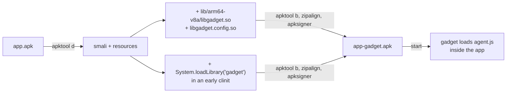

# Example: Gadget-Mode-Repackaging-Walkthrough

> [!info] Level 2 — intermediate
> Combines APK repackaging with Frida configuration: embed `frida-gadget.so` in the app itself, make the app load it, and configure it to run a script on startup — Frida without root and without `frida-server`.

## Goal

Instrument an app on a non-rooted device (or hide from `frida-server` detection) by injecting the Gadget, and understand what that trades away. Belongs to [[Anti-Detection-And-Gadget-Mode]].

## Steps

```text
$ apktool d app.apk -o app/                      # decode resources + smali
$ cp frida-gadget-17.x-android-arm64.so app/lib/arm64-v8a/libgadget.so
$ cat > app/lib/arm64-v8a/libgadget.config.so <<'EOF'
{ "interaction": { "type": "script", "path": "/data/local/tmp/agent.js", "on_change": "reload" } }
EOF
```

Load the library as early as possible — the main activity's (or `Application`'s) static initializer:

```smali
.method static constructor <clinit>()V
    .locals 1
    const-string v0, "gadget"
    invoke-static {v0}, Ljava/lang/System;->loadLibrary(Ljava/lang/String;)V
    return-void
.end method
```

```text
$ apktool b app/ -o app-gadget.apk
$ zipalign -p 4 app-gadget.apk app-aligned.apk
$ apksigner sign --ks my.keystore app-aligned.apk
$ adb install app-aligned.apk
$ adb push agent.js /data/local/tmp/
```

## Step by step

1. **What the Gadget is.** A shared library containing the Frida runtime. Once loaded into the process, it either waits for a client (`listen`, the default — `frida -U Gadget`), or runs a script itself (`script`), as configured.
2. **The config file** sits next to the library, named `lib<name>.config.so` so the installer extracts it with the libraries. `"type": "script"` makes the app self-instrumenting: no host connection needed.
3. **Matching ABI.** The gadget must match the process ABI: an app running as 64-bit loads from `lib/arm64-v8a/`. Put it in every ABI folder the app ships, or force one ([[Matching-Frida-Server-To-The-Target-ABI]]).
4. **Load early.** `System.loadLibrary("gadget")` in a static initializer runs when the class is first used; for the earliest point, use the `Application` subclass or the first content provider (`android:name` in the manifest). Code that runs before it is not instrumented.
5. **What it costs.** Re-signing changes the signing certificate, so signature checks, Play Integrity and some SDKs will notice; app updates won't install over it. Split APKs (`base.apk` + `split_config.*.apk`) must all be re-signed with the same key.
6. **What it hides.** No `frida-server` process, no port 27042 in `listen`-less script mode, no root needed — defeating server- and port-based detection ([[Blocking-The-Frida-Control-Port-Scan]]). But the gadget's own mappings and threads are still visible in `/proc/self/maps` and `/proc/self/task` ([[Faking-Proc-Reads-For-Frida-Detection]]).

## Diagram



## Compared with real code

- [[Dumping-An-InMemoryDex-Payload]] — the TUA app loads code at runtime; with a Gadget, that loader must run *after* the gadget for hooks to see it.
- [[Forcing-A-64-Bit-Split-Install-To-Dodge-The-32-Bit-Agent-Bug]] — a real case where the ABI the app ran under decided whether instrumentation worked.

## See also

- [[Anti-Detection-And-Gadget-Mode]]
- [[Frida]] and [[Frida-Server-Setup]] in [[Tools]]
- [[Classes]] in [[Dalvik-Bytecode]] — what `<clinit>` is and when it runs

## References

- [[Frida-Dynamic-Instrumentation-Bibliography|Bibliography]]
