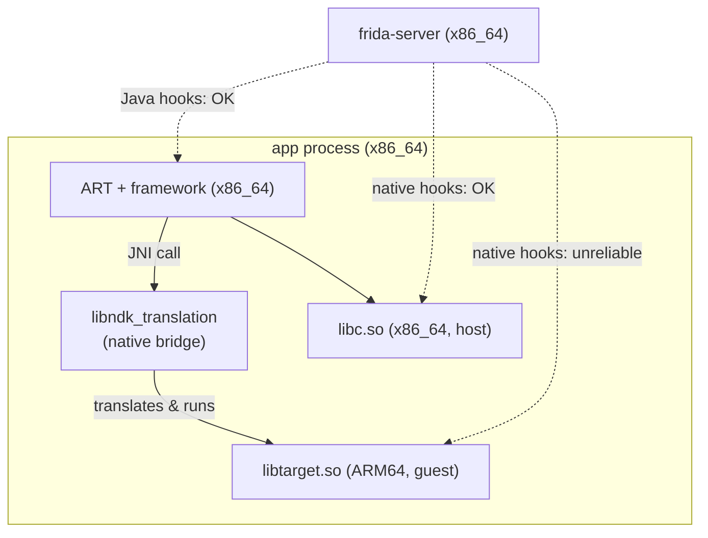

# Example: Running-ARM-Apps-On-An-x86-Emulator-With-Translation

> [!info] Level 2 — intermediate
> Combines emulator internals with Frida's view of a process: on an x86_64 emulator image with ARM translation, an ARM-only app runs inside an x86_64 process, and its ARM libraries are executed by a binary translator — which changes what Frida can hook.

## Goal

Understand what "the app runs on the emulator" means for an ARM-only app, and choose a setup where native hooks work. Belongs to [[Android-ABIs-And-Emulation]].

## Checking the setup

```text
$ adb shell getprop ro.product.cpu.abilist
x86_64,x86,arm64-v8a,armeabi-v7a              # ARM listed after x86: translation available
$ adb shell getprop ro.dalvik.vm.native.bridge
libndk_translation.so                          # the translator (0 = none)
$ adb shell pm dump com.example.app | grep primaryCpuAbi
    primaryCpuAbi=arm64-v8a                    # ARM-only APK -> installed as ARM
```

```javascript
console.log(Process.arch);                                  // "x64": the process itself is x86_64
console.log(Process.findModuleByName("libtarget.so"));      // often null: loaded by the translator
console.log(Process.findModuleByName("libndk_translation.so"));
```

## Step by step

1. **Native bridge.** Google's x86_64 emulator images (Android 11+ "Google APIs"/"Play" variants) ship `libndk_translation`, which runs ARM code by translating it to x86_64 at runtime. ARM ABIs then appear in `abilist` after the native ones.
2. **The process stays x86_64.** ART, libc, and the zygote are x86_64; only the app's ARM `.so` files are guest code. Frida (x86_64 server) sees an `x64` process.
3. **ARM libraries are invisible to normal module APIs.** They're loaded by the translator's own linker into its guest address space, so `Process.enumerateModules()` usually doesn't list them, and `Interceptor.attach` on an ARM address patches guest bytes that the translator has already turned into x86 code — the hook never fires or crashes.
4. **What still works:** everything at the Java layer (ART is native x86_64), and native hooks on *host* libraries (`libc.so` x86_64 — but ARM code calls the translator's guest libc, not necessarily the host one).
5. **For native work on ARM code**, use an ARM environment: a physical arm64 device, or an arm64 emulator image (fast on Apple-silicon hosts, slow elsewhere).
6. **Mixed-ABI APKs complicate this further.** If the APK has *some* x86_64 libraries, the app installs as x86_64 and never uses translation at all — missing ARM-only libraries then fail to load ([[Inspecting-An-APKs-Native-Libraries-Per-ABI]]).

## Diagram



## Compared with real code

- [[Inspecting-An-APKs-Native-Libraries-Per-ABI]] — PressReader ships `x86_64` builds of only one of its three libraries, so on an x86_64 image the native bridge wouldn't even be used for it.
- [[Forcing-A-64-Bit-Split-Install-To-Dodge-The-32-Bit-Agent-Bug]] — controlling which ABI an app installs under, on a real device.

## See also

- [[Android-ABIs-And-Emulation]]
- [[Checking-Process-Arch-And-Pointer-Size]]
- [[Matching-Frida-Server-To-The-Target-ABI]]

## References

- [[Frida-Dynamic-Instrumentation-Bibliography|Bibliography]]
