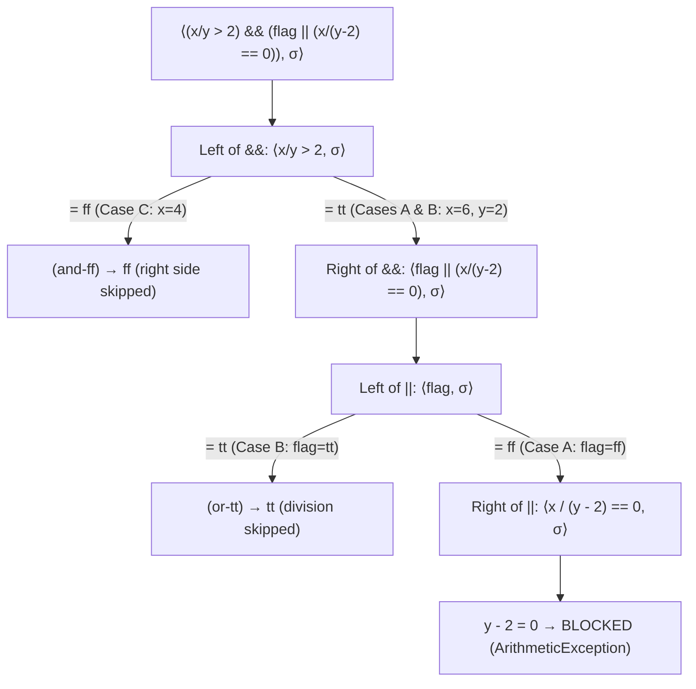

# Example: Evaluating Expressions in a State

## Goal

Trace big-step expression evaluation $\langle e, \sigma \rangle \to_e v$ against a concrete state $\sigma = \{x \mapsto 6, y \mapsto 2, \text{flag} \mapsto \text{false}\}$ (written $\phi$ in [[State-And-Expressions]]), contrasting an arithmetic/relational derivation with **short-circuit boolean evaluation** (`&&` and `||`) where a false left operand in `&&` or a true left operand in `||` prevents a blocked division-by-zero sub-expression from ever being evaluated — and connect this directly to how Dalvik compiles boolean guards into conditional branches (`if-le`, `if-eqz`, `if-nez`) in [[Dalvik-Instructions]] and [[Conditional-Branches]].

## Walkthrough

Consider the concrete state (frame):

```
σ = { x ↦ 6, y ↦ 2, flag ↦ ff }
```

### Part 1 — Arithmetic and relational sub-expression `(x / y) > 2`

Every variable leaf looks up its binding in $\sigma$ via the `(ide)` rule ($\sigma(x) = 6$, $\sigma(y) = 2$), checks the division side condition $2 \neq 0$, computes integer division $6 \;\text{div}\; 2 = 3$, and compares $3 > 2 \implies \text{tt}$:

```
  σ(x) = 6          σ(y) = 2
──────────── (ide) ──────────── (ide)
⟨x, σ⟩ → 6         ⟨y, σ⟩ → 2          2 ≠ 0    3 = 6 div 2
──────────────────────────────────────────────────────────── (exp÷)
                     ⟨x / y, σ⟩ → 3                                  ⟨2, σ⟩ → 2   tt = (3 > 2)
                     ────────────────────────────────────────────────────────────────────────── (exp>)
                                              ⟨(x / y) > 2, σ⟩ → tt
```

### Part 2 — Short-circuit boolean evaluation vs. a blocked right-hand side

Now consider the compound boolean expression:

```java
(x / y > 2) && (flag || (x / (y - 2) == 0))
```

Notice the sub-expression `x / (y - 2)`: in state $\sigma$, $\langle y - 2, \sigma \rangle \to 0$, so evaluating `x / (y - 2)` violates the side condition $n' \neq 0$ of `(exp÷)` and leaves $\langle x / (y - 2), \sigma \rangle$ **blocked** (at runtime in Java/Dalvik, an `ArithmeticException: divide by zero`). Whether the whole expression evaluates cleanly or blocks depends entirely on the short-circuit rules for `&&` and `||` (see [[Expression-Semantics-Rules]]):

```
Case A — σ = { x ↦ 6, y ↦ 2, flag ↦ ff }  (right operand of || MUST be evaluated → BLOCKED):
  1. Left of &&:  ⟨(x / y) > 2, σ⟩ → tt       (from Part 1; since it is tt, (and-tt) requires evaluating the right of &&)
  2. Left of ||:  ⟨flag, σ⟩ → ff              (since it is ff, (or-ff) requires evaluating the right of ||)
  3. Right of ||: ⟨x / (y - 2) == 0, σ⟩       needs ⟨x / (y - 2), σ⟩, where ⟨y - 2, σ⟩ → 0  ✗ BLOCKED (divisor = 0)

Case B — σ₁ = σ[tt / flag] = { x ↦ 6, y ↦ 2, flag ↦ tt }  (short-circuit (or-tt) skips the division):
                                                   σ₁(flag) = tt
                                                 ───────────────── (ide)
                                                 ⟨flag, σ₁⟩ → tt
  ⟨(x / y) > 2, σ₁⟩ → tt                         ─────────────────────────────────────────── (or-tt)
  (Part 1)                                       ⟨flag || (x / (y - 2) == 0), σ₁⟩ → tt
  ────────────────────────────────────────────────────────────────────────────────────────── (and-tt)
                    ⟨(x / y > 2) && (flag || (x / (y - 2) == 0)), σ₁⟩ → tt

Case C — σ₂ = σ[4 / x] = { x ↦ 4, y ↦ 2, flag ↦ ff }  (short-circuit (and-ff) skips the entire right half):
  ⟨x / y, σ₂⟩ → 2    ⟨2, σ₂⟩ → 2    ff = (2 > 2)
  ─────────────────────────────────────────────── (exp>)
             ⟨(x / y) > 2, σ₂⟩ → ff
  ────────────────────────────────────────────────────────────── (and-ff)
  ⟨(x / y > 2) && (flag || (x / (y - 2) == 0)), σ₂⟩ → ff
```

And in Dalvik smali (`p0` = `x`, `p1` = `y`, `p2` = `flag`), the short-circuit derivation rules `(and-ff)` and `(or-tt)` compile directly into early conditional jumps (`if-le`, `if-nez`) that jump **around** the `div-int` instruction:

```smali
# registers: p0 = x, p1 = y, p2 = flag (0 = false, 1 = true), v0/v1 = temporaries
div-int v0, p0, p1              # v0 = x / y
const/4 v1, 0x2
if-le v0, v1, :ret_false        # if (x / y <= 2) goto :ret_false   <-- implements (and-ff) short-circuit!

if-nez p2, :ret_true            # if (flag != false) goto :ret_true <-- implements (or-tt) short-circuit!

sub-int v0, p1, v1              # v0 = y - 2  (only reached when x/y > 2 AND flag == false)
div-int v0, p0, v0              # v0 = x / (y - 2)  <-- throws ArithmeticException if y == 2!
if-nez v0, :ret_false

:ret_true
const/4 v0, 0x1
goto :done

:ret_false
const/4 v0, 0x0

:done
```

## Step by step

1. **Variable lookup `(ide)` reads the state $\sigma$:** Every identifier leaf (`x`, `y`, `flag`) is resolved by applying the state function $\sigma(x) = 6$, $\sigma(y) = 2$, $\sigma(\text{flag}) = \text{ff}$. In Dalvik, $\sigma$ is the method's register file (`p0`, `p1`, `p2`).
2. **Arithmetic and relational operators evaluate both operands:** `(exp÷)` and `(exp>)` have premises for both left and right sub-expressions. In Part 1, $\langle x / y, \sigma \rangle \to 3$ succeeds because $\sigma(y) = 2 \neq 0$, and $\langle 3 > 2, \sigma \rangle \to \text{tt}$.
3. **Short-circuit rules omit the right premise when the left operand decides the outcome:** Unlike arithmetic operators, boolean `&&` and `||` each split into two big-step rules (see [[Expression-Semantics-Rules]]): `(and-ff)` concludes $\langle e_1 \mathbin{\&\&} e_2, \sigma \rangle \to \text{ff}$ from $\langle e_1, \sigma \rangle \to \text{ff}$ alone (never touching $e_2$), and `(or-tt)` concludes $\langle e_1 \mathbin{\|} e_2, \sigma \rangle \to \text{tt}$ from $\langle e_1, \sigma \rangle \to \text{tt}$ alone.
4. **Why short-circuiting matters for blocked sub-expressions:** In Case A ($\sigma$), neither short-circuit rule applies (`x / y > 2` is `tt` so `(and-tt)` demands the right operand, and `flag` is `ff` so `(or-ff)` demands `x / (y - 2) == 0`), forcing evaluation into $\langle x / (y - 2), \sigma \rangle$, which is **blocked** because $y - 2 = 0$. In Case B ($\sigma_1$ with $\text{flag} \mapsto \text{tt}$) and Case C ($\sigma_2$ with $x \mapsto 4$), the big-step derivation tree has **no subtree** for `x / (y - 2)` at all, so the whole expression evaluates cleanly to `tt` and `ff` respectively.
5. **Dalvik compilation turns short-circuit rules into branches:** At the bytecode level ([[Dalvik-Instructions]], [[Conditional-Branches]]), Dalvik does not have a short-circuit `and-boolean` instruction — instead, `(and-ff)` becomes `if-le v0, v1, :ret_false` and `(or-tt)` becomes `if-nez p2, :ret_true`, physically skipping the basic block containing `div-int v0, p0, v0`.

## Diagram



## See also

- [[State-And-Expressions]]
- [[Operational-Semantics]]
- [[Deriving-An-Arithmetic-Expression]]
- [[Expression-Semantics-Rules]]
- [[State-And-Environment-Substitution]]
- [[Dalvik-Instructions]] and [[Conditional-Branches]] in [[Dalvik-Bytecode]] — how compound boolean guards compile to sequences of `if-*` conditional jumps in smali.

## References

- [[Java-Fundamentals-Bibliography|Bibliography]]
