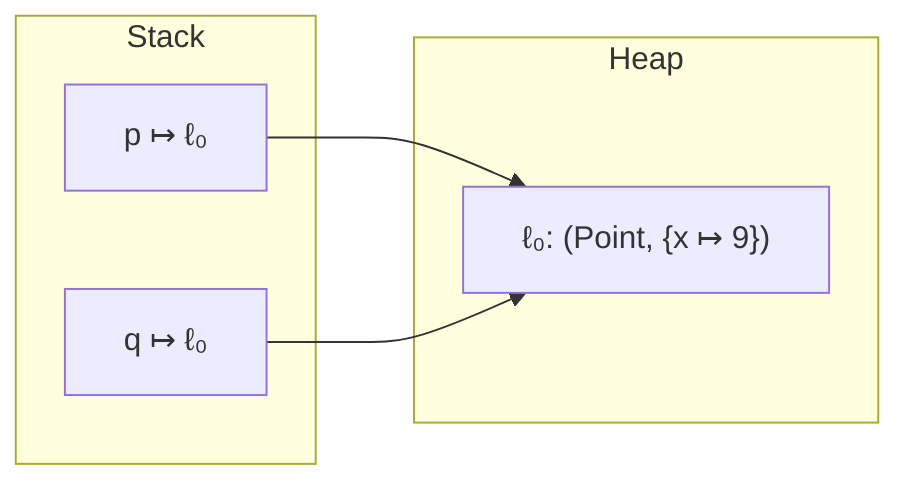

# Example: Aliasing-Two-References-One-Object

> [!info] Level 1 — basics
> One idea: assigning an object variable copies the *location* `ℓ`, not the object — so two variables can name the same heap object, and a write through one is visible through the other.

## Goal

Trace `q = p; q.x = 9;` in the `(σ, θ)` model and see why `p.x` changes. Belongs to [[Classes-And-Objects]].

## Program

```java
class Point { int x; }
Point p = new Point();
p.x = 1;
Point q = p;          // alias
q.x = 9;
int r = p.x;          // 9, not 1
```

## Trace

```
(new)+(decl-init)  Point p = new Point();   σ = {p↦ℓ₀}               θ = {ℓ₀ ↦ (Point, {x↦$})}
(field-write)      p.x = 1;                 σ unchanged              θ = {ℓ₀ ↦ (Point, {x↦1})}
(decl-init)        Point q = p;             σ = {p↦ℓ₀, q↦ℓ₀}         θ unchanged
(field-write)      q.x = 9;                 σ unchanged              θ = {ℓ₀ ↦ (Point, {x↦9})}
(field-read)       int r = p.x;             σ = {p↦ℓ₀, q↦ℓ₀, r↦9}
```

## Diagram



## Step by step

1. **`(new)` returns a location.** The object lives in `θ`; the variable `p` holds only `ℓ₀`.
2. **`Point q = p;` is an ordinary `(decl-init)`.** It evaluates `p` to its value — `ℓ₀` — and binds `q` to it. No object is created or copied.
3. **`(field-write)` changes θ, never σ.** `q.x = 9` evaluates `q` to `ℓ₀` and updates the object at `ℓ₀`. Both variables still hold `ℓ₀`.
4. **So `p.x` reads 9.** `(field-read)` follows `p` to the same `ℓ₀`. The two names are *aliases*.
5. **Contrast with primitives.** `int a = 1; int b = a; b = 9;` leaves `a = 1`: the value 1 itself is copied into `b`'s binding. Objects behave differently only because their value *is* a location.
6. **In bytecode** aliasing is a `move-object`: two registers holding the same reference.

## Compiled

```smali
new-instance v0, LPoint;
invoke-direct {v0}, LPoint;-><init>()V
const/4 v1, 0x1
iput v1, v0, LPoint;->x:I          # p.x = 1
move-object v2, v0                 # q = p   (copies the reference)
const/16 v1, 0x9
iput v1, v2, LPoint;->x:I          # q.x = 9 — same object as v0
iget v3, v0, LPoint;->x:I          # p.x -> 9
```

## Compared with real code

- [[Builder-Field-Initializers-And-Aliasing-In-PressReader]] — a real constructor that writes a list into a field and then mutates it through a second reference.

## See also

- [[Classes-And-Objects]]
- [[Objects-On-The-Heap]]
- [[Object-And-Method-Semantics-Rules]]
- [[Pass-By-Value-Of-References]] in [[Methods-And-Recursion]]

## References

- [[Java-Fundamentals-Bibliography|Bibliography]]
