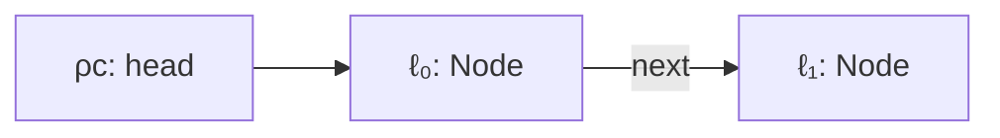

# Example: Garbage-And-Reachability

> [!info] Level 2 — intermediate
> Combines the stack, the heap, and statics: an object stays alive exactly as long as some chain of references from a root — a stack slot or a static field — reaches it; when the last chain breaks, the object is garbage, even though nothing in the program "deleted" it.

## Goal

Follow three objects through a short program and decide, at each point, which are reachable. Belongs to [[Memory-Model]].

## Program

```java
class Node { Node next; }
static Node head;                       // a root in ρc

void run() {
    Node a = new Node();                // ℓ₀
    Node b = new Node();                // ℓ₁
    a.next = b;
    head = a;
    b = null;
    a = null;
    head = new Node();                  // ℓ₂
}
```

## Reachability after each step

```
                    roots                          reachable           garbage
a = new Node()      σ: a↦ℓ₀                         ℓ₀
b = new Node()      σ: a↦ℓ₀, b↦ℓ₁                   ℓ₀, ℓ₁
a.next = b          σ: a↦ℓ₀, b↦ℓ₁                   ℓ₀, ℓ₁ (twice)
head = a            σ: a↦ℓ₀, b↦ℓ₁;  ρc: head↦ℓ₀     ℓ₀, ℓ₁
b = null            σ: a↦ℓ₀;  ρc: head↦ℓ₀           ℓ₀, ℓ₁ via ℓ₀.next
a = null            ρc: head↦ℓ₀                     ℓ₀, ℓ₁ via head
head = new Node()   ρc: head↦ℓ₂                     ℓ₂                  ℓ₀, ℓ₁
run() returns       ρc: head↦ℓ₂ (σ frame popped)    ℓ₂                  ℓ₀, ℓ₁
```

## Step by step

1. **Roots** are the starting points: every binding in every active stack frame, and every static field in `ρc` ([[Static-Fields-And-Class-Initialization]]). Registers of the current frames are roots in the bytecode.
2. **Reachable = there is a path** root → field → field → … → `ℓ`. `ℓ₁` stays reachable after `b = null` because `ℓ₀.next` still points to it.
3. **Garbage = no path at all.** After `head = new Node()`, nothing reaches `ℓ₀` and `ℓ₁` — they reference each other one way, but a chain *between* garbage objects doesn't count.
4. **The semantics never removes objects.** `ζ` only grows; garbage collection is an implementation step that deletes unreachable locations, invisible to the program because no rule can ever name them again.
5. **Statics outlive frames.** Had `head` not been reassigned, `ℓ₀` and `ℓ₁` would survive `run()` returning — this is how static collections cause memory leaks.

## Diagram (just before `head = new Node()`)



## Compared with real code

- [[Static-Command-Queue-Outliving-Its-Producer-In-PressReader]] — real objects kept alive by a static queue long after the method and object that created them are gone.

## See also

- [[Memory-Model]]
- [[Copying-References-Vs-Copying-Objects]]
- [[Aliasing-Two-References-One-Object]] in [[Classes-And-Objects]]

## References

- [[Java-Fundamentals-Bibliography|Bibliography]]
