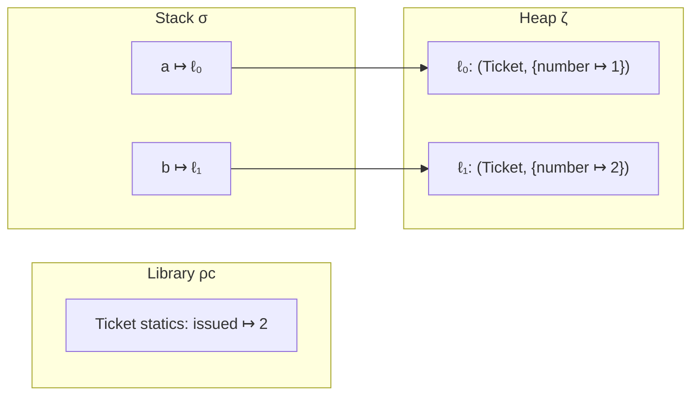

# Example: Static-Fields-And-Class-Initialization

> [!info] Level 1 — basics
> One idea: a static field belongs to the class, so it lives in the library region `ρc` — one copy, created when the class is initialized (its `<clinit>` runs on first use), shared by every object and every method.

## Goal

Place instance and static fields of one class in the three regions, and watch `<clinit>` fill the static one. Belongs to [[Memory-Model]].

## Program

```java
class Ticket {
    static int issued = 0;               // one per class  -> ρc
    final int number;                    // one per object -> ζ
    Ticket() { issued = issued + 1; number = issued; }
}
Ticket a = new Ticket();
Ticket b = new Ticket();
```

## Trace in `⟨ρc, σ, ζ⟩`

```
start                ρc: Ticket not yet initialized          σ: Ω          ζ: {}
first use (new)      <clinit>: issued = 0                    ρc(Ticket).statics = {issued ↦ 0}
new Ticket() #1      ζ += ℓ₀ ↦ (Ticket, {number ↦ 0})
  body               issued = 1;  number = 1                 ρc.statics = {issued ↦ 1}   ζ(ℓ₀).number = 1
decl-init a          σ = {a ↦ ℓ₀}
new Ticket() #2      ζ += ℓ₁ ↦ (Ticket, {number ↦ 0})
  body               issued = 2;  number = 2                 ρc.statics = {issued ↦ 2}   ζ(ℓ₁).number = 2
decl-init b          σ = {a ↦ ℓ₀, b ↦ ℓ₁}
```

## Diagram



## Step by step

1. **Static fields are not in objects.** `ζ(ℓ₀)` holds only `number`. `issued` exists once, attached to the class in `ρc`, whether there are zero or a thousand `Ticket` objects.
2. **`<clinit>` runs once, lazily**, the first time the class is actively used (here: the first `new Ticket()`), and before that use proceeds. All `static` initializers and `static { }` blocks are merged into it, in source order.
3. **Every object sees the same `issued`.** The constructor reads and writes it through the class, not through `this`: `sget`/`sput` instead of `iget`/`iput`.
4. **Lifetime: the whole program** (strictly, until the class is unloaded). That makes static fields *roots*: anything they reference stays alive ([[Garbage-And-Reachability]]).
5. **Sharing across threads.** Static state is shared by all threads, so concurrent `new Ticket()` calls race on `issued` — which is why real code guards shared static collections with locks.

## Compiled

```smali
.field static issued:I
.field final number:I

.method static constructor <clinit>()V
    .locals 1
    const/4 v0, 0x0
    sput v0, LTicket;->issued:I          # static region write
    return-void
.end method

.method constructor <init>()V
    .locals 1
    invoke-direct {p0}, Ljava/lang/Object;-><init>()V
    sget v0, LTicket;->issued:I
    add-int/lit8 v0, v0, 0x1
    sput v0, LTicket;->issued:I          # class-wide counter
    iput v0, p0, LTicket;->number:I      # this object's field (heap)
    return-void
.end method
```

## Compared with real code

- [[Static-Initializer-Choosing-An-Implementation-In-PressReader]] — a real `<clinit>` that fills three static fields, one of them chosen by a runtime flag.
- [[Static-Fields-And-Class-Initializer]] in [[Dalvik-Bytecode]] — the same idea at bytecode level.

## See also

- [[Memory-Model]]
- [[Tracing-A-Value-Through-The-Three-Regions]]
- [[Classes-And-Objects]]

## References

- [[Java-Fundamentals-Bibliography|Bibliography]]
