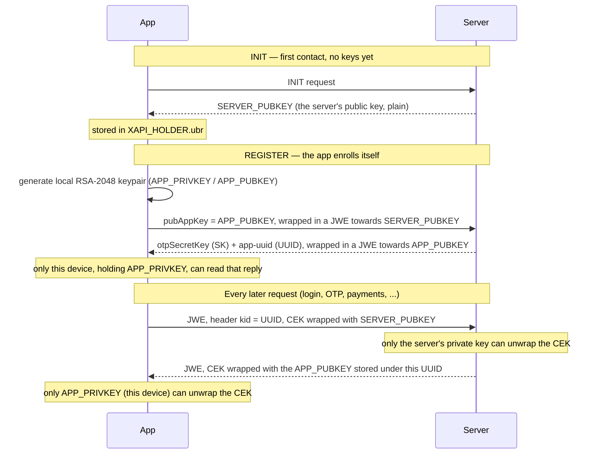

# XKey-Key-Exchange-And-Request-Flow

## Question / goal

The key material and the JWE wrapping mechanism were both traced in
[[JWE-OTP-Payload-And-Key-Investigation]] and [[Decrypting-JWE-Request-Response-Bodies]], but
piece by piece, as each was discovered. Pull it together into one place: **who generates which
key, who ends up holding which half, and which direction of traffic each key actually
protects** — stated as simply as possible, without re-deriving anything already proven
elsewhere.

## How this was found

Not a new investigation — this note is a synthesis of facts already established and confirmed
live in the three notes linked under "Relevant source" below. Nothing here is a new finding; it's
the mental model those notes only had implicitly.

## Relevant source

- [[JWE-OTP-Payload-And-Key-Investigation]] — where every key alias (`APP_PRIVKEY`,
  `APP_PUBKEY`, `SERVER_PUBKEY`, `SK`, `UUID`) was identified and, for `SERVER_PUBKEY`/`UUID`,
  extracted live from the device's keystore.
- [[Decrypting-JWE-Request-Response-Bodies]] — why the RSA-OAEP-256 wrapping makes offline
  decryption of captured ciphertext infeasible without one side's private key.
- [[XKey-Root-Detection-Check]] — the same `org.jod.mobile.android.xkey` library, for the
  (unrelated) root-flag telemetry riding on the same INIT/REGISTER calls.

## Excerpt

The two keypairs and the one shared secret involved, and where each one lives:

| Key / secret | Generated by | Private half lives | Public/secret half known to |
|---|---|---|---|
| **Server keypair** | the backend, per device registration | server only, never leaves it | the device, as `SERVER_PUBKEY` |
| **App keypair** | the app itself, locally, on first REGISTER | the device, as `APP_PRIVKEY` | the server, tied to this device's `UUID` |
| **`SK`** (OTP secret) | the backend | shared: both server and device know it | — (symmetric, not RSA-wrapped itself) |

The exchange, as a sequence:

## Analysis

Strip away the JOSE terminology and it's a very ordinary shape: **two separate RSA keypairs, one
per side, each generated by the side that keeps its private half.** Nothing is shared or derived
— each party just hands the other its own public key once, during onboarding, and from then on
every message going in that direction is locked with the recipient's public key, openable only by
the recipient's matching private key.

- **Device → Server** (login submission, OTP, payment confirmation, ...): the app wraps the CEK
  with `SERVER_PUBKEY`. Only the server's private key opens it — a key that is generated
  server-side and never sent anywhere, so this direction is genuinely closed to anyone without
  server access. This is the reason [[Decrypting-JWE-Request-Response-Bodies]] concluded offline
  decryption of the app's own requests isn't feasible: there is no copy of that private key to
  find, on the device or anywhere else reachable.
- **Server → Device**: the server wraps the CEK with the `APP_PUBKEY` it has on file for this
  specific registration. Only `APP_PRIVKEY` opens it — and unlike the server's key, this one *was*
  generated on the device itself and lives right there, in `XAPI_HOLDER.ubr`, alongside
  `SERVER_PUBKEY`. So, in principle, responses are the one direction that's actually decryptable
  offline from a rooted device, by extracting `APP_PRIVKEY` the exact same way
  [[JWE-OTP-Payload-And-Key-Investigation]] already extracted `SERVER_PUBKEY` (same file, same
  password, same certificate-extension trick — just not done yet for that specific alias).
- **`kid` is the address book entry, not a cryptographic key.** The header's `kid` (= `UUID`) just
  tells the server which stored `APP_PUBKEY` to encrypt the reply with — i.e. which device is
  asking. It plays no role in `SERVER_PUBKEY`, which every request from this device always uses
  regardless of `kid`.
- **`SK` (the OTP secret) rides inside this already-established channel** rather than being part
  of the RSA exchange itself — it's just JSON payload, encrypted like any other REGISTER response,
  using the same `APP_PUBKEY`-wrapping described above. It's the one secret genuinely shared by
  both sides (needed for both to compute/verify the same OTP), unlike the two RSA keypairs, where
  each half only ever exists on one side.

The practical upshot for this case study: hooking `JWEObject.encrypt`/`.decrypt` live (already
done in [[Decrypting-JWE-Request-Response-Bodies]]) sidesteps needing any of this key material at
all, for both directions at once — which is why that approach was preferred over extracting keys
offline. The key-extraction path documented here and in
[[JWE-OTP-Payload-And-Key-Investigation]] mainly matters for the one thing the live hook can't do:
decrypting **previously captured** ciphertext after the fact, and only for the server→device
direction, since the device→server direction has no recoverable private key at all.

## Generalizing the pattern

This "each side generates its own keypair, hands over only the public half, per-registration" shape
is a lightweight, app-layer stand-in for a real PKI enrollment (not unlike how TLS client
certificates or SSH host keys work) — worth recognizing on sight in any app that: (1) does a
first-run "INIT" call before login is even possible, (2) generates an RSA/EC keypair locally right
before or during account registration, and (3) tags every subsequent encrypted payload with some
opaque per-device identifier (a `kid`, a device-id header, ...). The identifier is very likely
just a lookup key for "which public key to encrypt this reply with," exactly as confirmed here for
`kid`/`UUID` — worth checking before assuming it has any deeper cryptographic meaning.

## Related concepts

- [[Java-Layer-Hooking]] — how the live confirmation of this flow (the JWE encrypt/decrypt hook)
  is actually implemented.

## Open questions / next steps

- [ ] Extract `APP_PRIVKEY` from `XAPI_HOLDER.ubr` (same procedure already used for
      `SERVER_PUBKEY`/`UUID` in [[JWE-OTP-Payload-And-Key-Investigation]]) and use it to decrypt a
      previously-captured server→device JWE response offline, as an end-to-end confirmation of the
      direction this note attributes to it.
- [ ] Confirm whether `SERVER_PUBKEY` is genuinely per-device (a fresh server-side keypair per
      registration) or shared across many devices and just re-served identically at INIT — not yet
      distinguishable from a single capture (open question already flagged in
      [[JWE-OTP-Payload-And-Key-Investigation]]).

## See also

- [[JWE-OTP-Payload-And-Key-Investigation]]
- [[Decrypting-JWE-Request-Response-Bodies]]
- [[XKey-Root-Detection-Check]]
- [[Case-Studies]]
